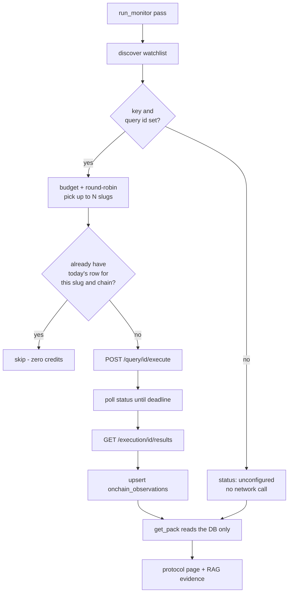

# Architecture

DeFiScope AI is a monorepo pairing a **Next.js 16 research dashboard** with a
**FastAPI analytics service**. The split is deliberate: deterministic research
math lives in Python (testable, pandas-native), while presentation, navigation
and the grounded chat live in React over a typed API contract.

Everything degrades gracefully. With no API key and no network the service still
scores protocols, fires threshold alerts, renders the board from its own
snapshots, and answers chat questions *extractively* from quoted evidence — the
LLM is an enhancement, never a dependency.

## Repository layout

```
DeFiScope-AI/
├── apps/web/                       # Next.js 16 + React 19 + TS + Tailwind v4 + Recharts
│   ├── app/
│   │   ├── (dashboard)/            # RSC pages: board, protocols/[slug], alerts, ask, compare, about
│   │   ├── login/                  # outside the dashboard group: no sidebar, no session required
│   │   └── api/                    # same-origin route handlers: chat, run-check, brief-export/[slug],
│   │                               #   auth/{login,logout,switch,ticket}
│   ├── components/
│   │   ├── auth/                  # login-form, user-menu (+ server variant), sidebar sign-in footer
│   │   ├── dashboard/             # stat-cards, protocol-table, sparkline, alert-feed/item,
│   │   │                          #   risk-watchlist, compare-matrix, compare-picker, withheld-banner
│   │   ├── chat/                  # chat-panel (WS streaming + HTTP fallback)
│   │   ├── TvlChart, RiskTrendChart, IndicatorCard, RiskBadge, app-sidebar, mode-toggle …
│   │   └── ui/                    # shadcn primitives
│   ├── lib/                       # api.ts (server client + bearer), api-config.ts (client-safe
│   │                              #   formatting/URLs), auth.ts (session, server-only),
│   │                              #   auth-proxy.ts, demo-accounts.ts, api-types.ts (codegen), types.ts
│   ├── proxy.ts                   # UX-only unauthenticated redirect — never the security boundary
│   └── e2e/                       # Playwright specs (auth.setup.ts seeds a storageState)
├── services/api/                    # FastAPI + pandas analytics service
│   ├── app/
│   │   ├── clients/defillama.py    # one async client, five endpoints, retry/backoff, best-effort enrichment
│   │   ├── analysis/metrics.py     # pure metric primitives (all unit-tested)
│   │   ├── analysis/scoring.py     # seven explainable risk indicators → renormalized composite
│   │   ├── services/protocols.py   # orchestration + bounded TTL cache + market discovery
│   │   ├── services/dashboard.py   # DB-first board reads, sparklines, aggregate stats, risk history
│   │   ├── services/briefs.py      # LLM brief + deterministic template fallback (same sections)
│   │   ├── services/alerts.py      # pure rule evaluation, idempotent persistence, notify fan-out
│   │   ├── services/export.py      # brief → Markdown / CSV / PDF (reportlab)
│   │   ├── notifiers/              # console, webhook, slack, discord, telegram, email
│   │   ├── rag/                    # chunking · embeddings · lexical(BM25) · ingest · service
│   │   ├── routers/               # protocols · briefs · alerts · dashboard · chat · auth
│   │   ├── security/              # passwords (scrypt) · principal (Subject/Scope) · policy
│   │   │                          #   (RBAC gate → ABAC predicates → Decision) · deps (require,
│   │   │                          #   get_subject) · seed (demo users) · ws_tickets
│   │   ├── db.py                  # SQLAlchemy models; SQLite default, Postgres + pgvector
│   │   ├── reference_data.py      # curated protocol→stablecoin map (data/*.json)
│   │   ├── config.py              # pydantic-settings (DEFISCOPE_ env prefix)
│   │   └── main.py                # lifespan, CORS, scheduler (30-min pass), health/readiness
│   ├── alembic/                    # migrations (schema source of truth)
│   ├── data/protocol_stablecoins.json
│   └── tests/                      # 229 pytest: metrics, scoring, clients, alerts, dashboard,
│                                   #   watchlist, export, notifiers, RAG (ingest + service), API, policy,
│                                   #   auth, scope (respx, no live network)
├── services/db/                    # Postgres 16 + pgvector, built on Alpine (not the Debian
│   └── Dockerfile                  #   pgvector image): compiles pgvector from source; lower CVE profile
├── docs/                           # methodology · architecture · primer · sample research · roadmap
├── scripts/tunnel.sh               # Cloudflare quick-tunnel publisher
├── Makefile                        # task runner wrapping the flows below
└── docker-compose.yml              # builds db + api + web (all Alpine), plus opt-in `llm` profile
```

## Data flow

```
                         ┌──────────── DefiLlama (public, no key) ────────────┐
                         │ /protocols  /protocol/{slug}  fees/…  /overview/dexs│
                         │                        coins.llama.fi /chart         │
                         └───────────────┬──────────────────────────────────────┘
                                         ▼
                     clients/defillama.py  ──normalize──▶  ResearchPack
                                         │            (detail + summary + fees
                                         │             + volume + peg histories)
                                         ▼
                     analysis/metrics.py (pure primitives)
                                         ▼
                     analysis/scoring.assess ──▶ RiskAssessment
                    (7 indicators → renormalized composite + data_gaps)
                                         │
        ┌──────────────┬────────────────┼─────────────────┬───────────────┐
        ▼              ▼                ▼                 ▼               ▼
  services/        services/        services/        services/       rag/ingest
  protocols        dashboard        briefs           alerts          (docs + evidence
  (TTL cache,      (DB-first        (LLM |            (rules →        chunks → BM25/
   discovery)      reads +          template)          persist +       cosine index)
        │           hydrate)                            notify)            │
        ▼              ▼                ▼                 ▼               ▼
     routers/protocols · dashboard · briefs · alerts · chat  ── OpenAPI ──▶ apps/web
                                        │                                   (RSC + codegen types)
                                        ▼
                          notifiers/  (console/webhook/slack/discord/telegram/email)
```

The scheduler (`main.py`) drives a **30-minute monitoring pass**: discover the
watchlist (curated slugs + top-N by TVL), fetch packs concurrently, evaluate
rules, persist daily snapshots + alerts, and fan new alerts out to configured
channels. The same pass runs once at startup as a **background task** (never
awaited in the lifespan, so a slow crawl can't delay the port bind or fail
readiness). The RAG index is hydrated synchronously from any persisted chunks
(offline-capable from the first request) and refreshed in the background after
warm-up, because the evidence chunks are derived from the snapshots/alerts.

## Persistence

SQLAlchemy models in [`db.py`](../services/api/app/db.py) back six tables:

| Table | Purpose |
|---|---|
| `protocol_snapshots` | One row per protocol per day (unique `(slug, date)`): the full normalized overview + composite score/band. Enables a **DB-first** dashboard, sparklines and the risk-score trend, independent of upstream retention. First sight of a slug backfills the whole DefiLlama history. |
| `alert_records` | Durable alert log keyed by deterministic `alert-{sha256(slug:rule:day)}` id, so re-runs **upsert** rather than duplicate. `notified_at` is the delivery cooldown/dedup marker. |
| `chat_chunks` | One indexed passage per RAG chunk. `chunk_id` is a provenance-scoped content hash (`doc_id ␟ section ␟ body`) so identical boilerplate across sources gets distinct ids while unchanged text keeps a stable id; `doc_id` lets a whole source be replaced on refresh. `embedding` is **pgvector `Vector(1536)` on Postgres**, plain JSON on SQLite (ranked in-process). |
| `users` | Local accounts: `email` (unique), `password_hash`, `role`, `team`, `clearance` 1–3, `allowed_categories` / `allowed_chains` (JSON, `["*"]` = unrestricted), `is_active`. These columns *are* the ABAC attribute set — no separate entitlement store. |
| `sessions` | Opaque session tokens, `token_hash` (SHA-256) as the primary key, `user_id`, `expires_at`. The raw token exists only in the client's httpOnly cookie and in the `Authorization` header on the wire — a database read cannot replay a session. |
| `onchain_observations` | One row per protocol per chain per day (unique `(slug, date, chain)`): the four Dune-measured activity metrics, `execution_id` for provenance, `fetched_at`. Every metric column is **nullable**, so a partially reported day stays a gap instead of turning into a zero. Aggregated on read across chains — see the next section. |

Default DB is **SQLite** (zero setup); the same models run against the
docker-compose **Postgres** via `DEFISCOPE_DATABASE_URL`. Schema changes go
through **Alembic** (`services/api/alembic`); `init_db()` also adds any missing
column idempotently as a safety net for a volume that predates a deploy, and
best-effort `CREATE EXTENSION vector` so a non-pgvector install degrades to
lexical chat instead of crashing.

## On-chain analytics (second provider)

DefiLlama answers "how much value is parked here". It cannot answer "is anyone
using it" — TVL is a stock, and fee adapters vary in what they count. Dune
answers the second question from raw chain data.

The arrangement is deliberately **additive**: DefiLlama keeps TVL, fees,
revenue, volume and prices; Dune adds four contract-level activity metrics per
tracked contract set per UTC day. **None of the seven risk indicators reads
on-chain activity**; [methodology.md](methodology.md) states the bar for ever
changing that.



### Why the pack never calls Dune

`app/services/onchain.py` has two entry points with a hard split:

- `refresh(session, http, slugs, settings)` executes queries and writes rows. It
  is called from exactly one place, `run_monitor`, and never from a request
  handler. Opening a protocol page therefore cannot spend credits or wait on a
  SQL queue.
- `load(session, slug)` reads persisted rows and nothing else. `get_pack()` uses
  this, which is what keeps the 50-protocol dashboard free of both an N+1 query
  and a Dune round trip.

The pack's `onchain` block is rebuilt from the DB even on a **cache hit**, because
the two caches age at different rates (5-minute research TTL vs one-day rows) and
a stale number is the one thing this block exists not to be.

### The credit guard

Three independent brakes, in the order they fire:

1. **Today-row short-circuit.** A row for `(slug, chain, today)` skips the
   execution entirely, so a re-run of the pass costs nothing. Steady state is
   near-zero executions.
2. **Server-side result cache.** Executions send `max_age`, so Dune serves its
   own cached result for a query whose answer cannot have changed.
3. **Per-pass budget with a round-robin cursor.** At most
   `DUNE_MAX_PROTOCOLS_PER_PASS` protocols are refreshed per pass (default 8),
   rotating from where the last pass stopped. A 60-slug watchlist drains over
   eight passes instead of stalling one, and adding protocols never multiplies
   the per-pass cost.

A wall-clock deadline (`DUNE_POLL_TIMEOUT_SECONDS`) bounds execute → poll →
results. On expiry the protocol is **deferred**, not failed: the pass continues
and the next one retries.

### Failure posture

`run_monitor` wraps the refresh in `try/except Exception` + `logger.exception`,
the same posture as the notify and snapshot steps — a Dune outage costs the pass
its on-chain block, never the pass. Per-chain failures are isolated the same way,
so one unreachable chain cannot erase the others.

### Status is part of the contract

`unconfigured | no_data | stale | partial | ok` is a first-class output, not an
inference the UI makes:

| Status | Meaning |
|---|---|
| `unconfigured` | No key and/or no query id. Nothing can be measured. |
| `no_data` | Configured, but no curated contract mapping for this slug, or no rows yet. |
| `stale` | Rows exist, but the newest is older than `ALERT_STALE_DATA_DAYS`. |
| `partial` | The newest day is missing one of the mapped chains. Numbers cover the chains that reported; the missing ones are named. |
| `ok` | Every mapped chain reported for the newest day. |

`ProtocolResearch.onchain` is **non-optional** for exactly this reason: an absent
block could not distinguish "no Dune key" from "no data", and both must be
distinguishable from zero.

## Key decisions

1. **Deterministic core, generative edge.** Every number comes from a tested pure
   function in `analysis/`. The LLM never computes — it only composes prose from a
   structured evidence pack (`services/briefs.py`), and a deterministic template
   produces the same sections offline. `generated_by` is always surfaced.
2. **Missing data is visible data.** Indicators that can't be computed return
   `None`, are excluded from the composite (weights renormalized), appear under
   `data_gaps`, and render in the UI. Unknown is never rendered as "safe" — and
   an absent fees/price feed stays a gap, never a zero.
3. **Resilient against a public upstream.** One client wraps retry/backoff
   (honouring `Retry-After`, no retry on 404), bounds the per-protocol TTL cache
   (LRU, 5-min) and the crawl concurrency, and treats the fees/volume/peg
   enrichment as strictly best-effort: a dead secondary host degrades to a data
   gap, not a failed pack. One bad protocol never sinks the board.
4. **DB-first reads with a serialized live fallback.** The dashboard renders from
   snapshots; it runs a live monitoring pass only when the newest capture is
   stale (> 6h), guarded by an `asyncio.Lock` so a cold-start burst triggers a
   single crawl, not N.
5. **Method-aware chat grounding.** Cosine (`[0,1]`) and BM25 (unbounded) scores
   aren't comparable, so relevance is gated by the method that produced them: a
   fixed cosine floor for the vector path, a shared-informative-term bar for the
   lexical path. The chat then refuses (`generated_by="none"`) rather than quote
   irrelevant passages. See [methodology](methodology.md).
6. **Honesty is structural, not a prompt.** Alerts embed their triggering metric /
   observed value / threshold; notifier failures are logged by exception *type*
   only (never `str(exc)`, which would leak a secret-laden webhook URL); exports
   neutralize spreadsheet formula injection. Provider secrets are read only to
   open an outbound connection and are never persisted or logged.
7. **SQLite first, Postgres when shared.** Zero-setup dev; the compose stack
   swaps in Postgres + pgvector with no code change.
8. **Authorization is enforced where it cannot be bypassed.** The API port and the
   WebSocket are reachable without Next, so `proxy.ts` is UX only and every
   decision is made inside the FastAPI handler — RBAC verb, then ABAC predicates
   over the real resource and the current environment (see
   [Authentication and authorization](#authentication-and-authorization)).

## API surface (self-documented at `/docs` via FastAPI)

| Endpoint | Purpose |
|---|---|
| `POST /api/auth/login` | Email + password → opaque session token + subject (uniform 401 on failure, constant-time) |
| `POST /api/auth/logout` | Revoke the session row |
| `GET /api/auth/me` | The caller's subject: role, clearance, scope, permission list |
| `POST /api/auth/switch` | `demo` mode only: re-issue a session for another seeded account (403 with `policy="auth.switch"` in `required`) |
| `POST /api/auth/ticket` | Mint a single-use 60-second WebSocket ticket bound to the session |
| `GET /api/protocols` | Normalized comparison board with risk bands (live, cached); filtered by subject scope |
| `GET /api/protocols/{slug}` | TVL series, chain breakdown, full evidence payload |
| `GET /api/dashboard` | DB-first board: latest snapshot per protocol + stats + alerts + aggregate history |
| `GET /api/protocols/{slug}/history?days=` | Trailing daily TVL points (sparkline/trend) |
| `GET /api/protocols/{slug}/risk-history?days=` | Daily composite risk-score trend (scored days only) |
| `GET /api/briefs/{slug}` | Structured research brief (LLM or template) + markdown + sources |
| `GET /api/briefs/{slug}/export?format=md\|csv\|pdf` | Brief rendered for download (`Content-Disposition` attachment) |
| `GET /api/alerts` | Today's persisted alerts (fast DB read, no crawl) |
| `GET /api/alerts/history?limit=` | Durable alert log |
| `POST /api/alerts/run` | Manual/full monitoring pass: crawl → evaluate → persist → notify. Needs `monitor:run` plus the freshness and business-hours predicates |
| `POST /api/chat` | Grounded Q&A, single request/response (WS fallback) |
| `WS /ws/chat` | Streaming chat (`token` / `citations` / `done` frames; chosen over SSE because Cloudflare quick tunnels pass WS but not SSE). Authenticated by a single-use `?ticket=`, validated before `accept()` |
| `GET /api/health` | Liveness (always 200; surfaces DB state + curated protocol list) |
| `GET /api/health/ready` | Readiness (503 until the DB answers, for compose/k8s probes) |

The browser never sees the compose-internal API host: server components and the
same-origin Next route handlers (`/api/chat`, `/api/run-check`,
`/api/brief-export/[slug]`) proxy to the backend, so `NEXT_PUBLIC_API_URL` stays
server-only and only `NEXT_PUBLIC_API_PUBLIC_URL` / `…_WS_URL` (build-time) are
opened by the client. Types are generated from the exported OpenAPI
(`make gen-types`; CI drift-checks with `check:types`).

## Authentication and authorization

Two layers, deliberately separate. **Authentication** answers *who is calling*
(local accounts, opaque sessions). **Authorization** answers *what they may
touch*: an RBAC verb gate, then ABAC predicates over the real resource and the
current environment.

### Why FastAPI is the authority

The dashboard reaches the API through two doors Next.js cannot stand in front of:

1. **The published API port** — `:8000` in dev, `:3646` under compose. Anything
   `curl` can reach, `curl` can call; `proxy.ts` only ever sees requests to the
   web port.
2. **The WebSocket** — the browser opens `/ws/chat` directly against the API
   origin (a Next route handler cannot proxy a WS upgrade), so no cookie-scoped
   matcher applies.

So the check lives in the request handler, and
[`proxy.ts`](../apps/web/proxy.ts) is documented as **UX only**: it saves an
unauthenticated visitor a wasted render by redirecting to `/login?next=…`, and it
is never the reason a resource is safe.

The web tier holds the session in an httpOnly, `SameSite=Lax` cookie and forwards
it as `Authorization: Bearer …` from [`lib/api.ts`](../apps/web/lib/api.ts) — the
single edit point that covers every server→API call. Because a scoped response
differs per subject, that module also switches to `cache: "no-store"` whenever a
token is present; otherwise Next's shared data cache would replay one analyst's
board to another.

### The decision pipeline

```
request ─▶ get_subject ─▶ require("<verb>") ─▶ ABAC predicate(s) ─▶ handler
             │                  │                     │
             │  token → sha256 → sessions row          │  subject attrs — role, clearance,
             │  → users row → Subject                 │    allowed_categories, allowed_chains
             │  401 absent / expired                  │  × resource attrs — category, top_chain,
             │                  │                     │    severity, confidence
             │                  │                     │  × environment — freshness, clock
             │                  └── 403 missing verb  └── Decision{allowed, policy,
                                                              reason, failed_predicate}
```

[`security/policy.py`](../services/api/app/security/policy.py) is **pure and
I/O-free**, in the same style as `analysis/metrics.py`, so the whole matrix is
unit-testable without a database. A denial is never a bare 403: the body names
the policy and the failing predicate, and the UI renders it as an explanation
("Snapshot is fresh — a crawl would be redundant") instead of an error toast.

### Policy table

| Policy id | Applies to | Rule | Denial shape |
|---|---|---|---|
| *(RBAC verb)* | every route | `subject.role` holds the route's permission | 403 naming the missing `permission` |
| `scope.category_chain` | protocols, dashboard, briefs, chat citations | resource `category` ∈ subject categories (or `*`) **and** `top_chain` ∈ subject chains (or `*`) | 403 naming the failing attribute |
| `alerts.severity_clearance` | alert lists | `severity != "critical"` or `clearance >= 2` | Content withheld, **count kept**: "3 critical alerts withheld — clearance 2 required" |
| `briefs.export.confidence_gate` | brief export | `confidence != "low"` or role ∈ `{risk_officer, admin}` | 403: export needs sign-off |
| `monitor.run.freshness` | `POST /api/alerts/run` | snapshot older than `STALE_AFTER` (6h), or role == `admin` | 403 with the age of the last capture |
| `monitor.run.business_hours` | `POST /api/alerts/run` | weekday, 07:00–22:00, or role == `admin` | 403 naming the window |

`ROLE_PERMISSIONS`: `viewer` → read-only (`protocols:read`, `alerts:read`,
`briefs:read`, `chat:ask`); `analyst` → `+ briefs:export`, `monitor:run`;
`risk_officer` → `+ audit:read`; `admin` → all nine verbs, including the reserved
`users:manage` / `policy:manage` that no route enforces yet (they exist so the
future admin surface has a name to check).

Withholding is a deliberate choice in two places. Critical alerts keep their
**count**, so "no alerts today" is never shown while alerts exist. And an
out-of-scope protocol page renders the denial rather than `notFound()`: a 404
would claim the protocol does not exist, when the truth is that this caller may
not see it.

### Modes

`DEFISCOPE_AUTH_MODE` gives one codebase three postures:

| Mode | Behaviour |
|---|---|
| `off` | `get_subject` returns a synthetic all-permissions principal. Pre-auth behaviour, and what keeps the pure-analysis tests independent of the security layer |
| `demo` *(default)* | Seeds the four [`@demo` accounts](../README.md#demo-accounts) and enables `POST /api/auth/switch` + the header role switcher |
| `required` | Seeds nothing, rejects `switch` with `403 policy="auth.switch"` |

### Session and ticket details

- Passwords use **`hashlib.scrypt`** (N=2¹⁴, r=8, p=1, dklen=32) with a per-user
  salt, encoded as `scrypt$n$r$p$salt$hash` so parameters can be raised later
  without invalidating stored passwords. The plan called for Argon2id;
  `argon2-cffi` is not in `uv.lock`, and adding a native build dependency to an
  offline-first image was judged a worse trade than stdlib scrypt, which is
  memory-hard and adequate here. Verification is constant-time, and an unknown
  email is verified against a dummy hash so a missing account is not
  distinguishable by response latency.
- Sessions are opaque `secrets.token_urlsafe(32)` tokens. Only the SHA-256 is
  persisted, so the table is not a credential store and a database read cannot
  replay a session. Lifetime is 12h (`DEFISCOPE_AUTH_SESSION_HOURS`).
- The WebSocket cannot send headers, so `POST /api/auth/ticket` exchanges the
  cookie for a **single-use 60-second ticket**. It travels in the query string, is
  consumed on first use, and a `1008` close prompts exactly one retry with a fresh
  ticket. The long-lived token never enters a URL.

### Known limitation

Chain scoping matches `ProtocolSnapshot.top_chain`, the persisted primary chain.
A protocol bridged across several chains is therefore visible to anyone scoped to
*any* of its chains. Exact multi-chain membership needs a `chains` JSON column on
`protocol_snapshots` — deferred and stated here rather than silently approximated.

## Operational notes

- **APScheduler runs in-process.** A multi-worker deployment must move
  `run_monitor` to a single dedicated worker/cron so passes don't multiply.
- **Rate limiting is the open exposure.** `POST /api/alerts/run` now requires
  `monitor:run` plus the freshness/business-hours predicates, so anonymous crawls
  are closed — but a logged-in `analyst` can still force one pass per stale window
  and a logged-in account can still spend the LLM budget. Per-subject rate limits
  and cost quotas are roadmap #17's remaining half.
- One failing protocol is logged and skipped (`get_packs`); one dead notifier
  channel is logged and swallowed without aborting the pass.
- The web tier degrades to an explicit "API unavailable" state with the exact
  restart command rather than an empty dashboard.
